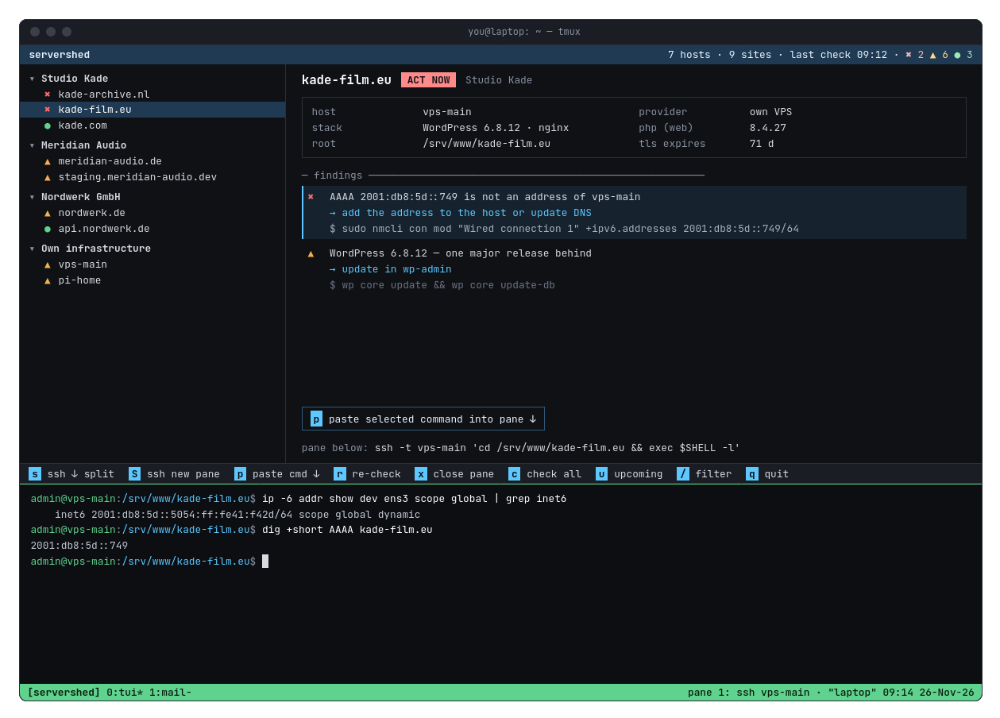

# servershed

Local, read-only overview of VPSes and shared-hosting accounts. TUI first (Textual), CLI later.

*Design mockup with fictional data: this is where servershed is heading, not what it looks like today.
Findings with suggested commands and the `p` paste into a tmux pane are not built yet.*

    python3 -m venv .venv && .venv/bin/pip install -e '.[dev]'
    .venv/bin/servershed                 # TUI: r refresh, R refresh all, s ssh, v raw facts, q quit
    .venv/bin/servershed --dev           # same, app.tcss reloads live on save
    .venv/bin/watchfiles --filter servershed.devtools.CodeFilter '.venv/bin/servershed --dev' src
                                         # restart on .py/.sh saves; app.tcss stays live
    .venv/bin/servershed lint                 # validate inventory.yaml
    .venv/bin/servershed probe [asset...]     # run the read-only probe, print raw facts
    .venv/bin/servershed probe --save tests/fixtures/local   # real output, git-ignored

Rule: the tool never changes a host. The probe is POSIX sh, no sudo, piped over the
system `ssh` (uses ~/.ssh/config). Assets with `kind: external` / `probe: false` are never ssh'd.

Inventory lookup: `-i PATH`, then `$SERVERSHED_INVENTORY`, then `./inventory.yaml`,
then `~/.config/servershed/inventory.yaml`.

Sensitive data stays out of git: `inventory.yaml`, `tests/fixtures/local/`, any `*.sqlite`
history and `.servershed/` cache are ignored. Start from `inventory.example.yaml`.

## License

Apache-2.0, see `LICENSE`.

## Leak guard

A pre-commit and commit-msg hook block commits that contain real estate data. Enable once per clone:

    git config core.hooksPath .githooks

Terms come from your git-ignored `inventory.yaml` (names, ssh aliases and what `ssh -G` resolves them
to, sites, docroots) plus `.servershed/denylist` (git-ignored, one term per line). Terms that also
appear in `inventory.example.yaml` are skipped. Check with `.venv/bin/python scripts/leak_guard.py terms`.
